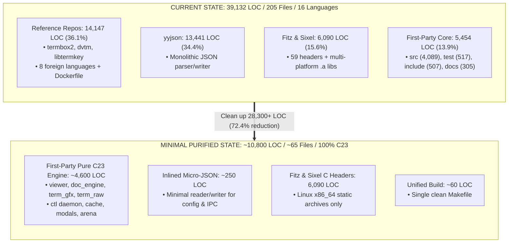

# Codebase Cleanup & Minimization Master Plan

> **Mandate**: *"Reduce the codebase to the minimum version which works and compiles; not even 1 line of extra code which our binary doesn't need to compile."*

Based directly on the comprehensive architectural audit in [`distribution.md`](file:///home/aditya/Downloads/pdf-cli/distribution.md), this document establishes the master plan to eliminate all dead weight, unused cloned repositories, standalone test harnesses, non-target binary archives, and bloated third-party dependencies from `pdf-cli`.

---

## 1. Executive Summary & Baseline Audit

### Current Codebase Baseline (From `distribution.md`)
- **Total Files**: 205
- **Total Code LOC**: **39,132**
- **Total Blank Lines**: 9,187
- **Total Comment Lines**: 15,289
- **Detected Languages**: 16 (C, C/C++ Header, PHP, Bourne Shell, Markdown, make, YAML, Rust, Ruby, Zig, D, Nim, JSON, Go, Python, Dockerfile)

### The Dissection: Required vs. Superfluous Code

To compile the `pdf-cli` binary, the compiler requires **only**:
1. The C23 application source files (`src/*.c`) and public headers (`include/pdfcli/*.h`).
2. The MuPDF Fitz C interface headers (`depends/go-fitz/include/mupdf/`) and static libraries for the host OS/architecture (`libmupdf_linux_amd64.a`, `libmupdfthird_linux_amd64.a`).
3. The Sixel graphics header (`depends/libsixel/include/sixel.h`) and static library (`libsixel.a`).
4. A JSON parser/serializer (currently the monolithic `yyjson` at 13,441 LOC, which can be replaced by a ~250 LOC micro-parser).
5. A single canonical build script (`Makefile`).

Everything else in the current directory is **dead weight that the binary never executes or links**:

| Component | Current Files | Current Code LOC | % of Codebase | Needed by Binary? | Planned Action |
|:---|---:|---:|---:|:---:|:---|
| **Reference Repositories** (`termbox2`, `dvtm`, `libtermkey`) | 96 | 14,147 | 36.15% | **NO (0 LOC)** | **Delete Entirely** |
| **Standalone Test Suites** (`test/`) | 3 | 517 | 1.32% | **NO (0 LOC)** | **Delete Entirely** |
| **Monolithic `yyjson` Dependency** | 2 | 13,441 | 34.35% | Replaced by ~250 LOC | **Replace with Micro-JSON** |
| **Duplicate Build Scripts** (`build.sh`) | 1 | 105 | 0.27% | **NO** (use Makefile) | **Delete `build.sh`** |
| **External Presets Asset** (`default_presets.json`) | 1 | 36 | 0.09% | Can be static C string | **Inline into C & Delete `assets/`** |
| **Orphaned Binary Asset** (`assets/probe.png`) | 1 | 0 | 0.00% | **NO** (already in C array) | **Delete** |
| **Multi-Platform `.a` Archives** (macOS, ARM64) | 6 archives | 0 | 0.00% | **NO** (Linux x86_64 only) | **Delete (~100 MB saved)** |
| **MuPDF Fitz Headers** (`depends/go-fitz`) | 59 | 5,398 | 13.79% | **YES** | **Retain Minimal Headers** |
| **Sixel Library Header** (`depends/libsixel`) | 1 | 692 | 1.77% | **YES** | **Retain** |
| **Core C23 Application Engine** (`src/` & `include/`) | 40 | 4,596 | 11.75% | **YES** | **Audit & Strip Dead Code** |

---

## 2. Target Architecture Comparison



---

## 3. Step-by-Step Cleanup Plan

### Phase 1: Complete Eradication of Reference Repositories
#### Objective
Eliminate the three repositories that were cloned locally for reference during tab and terminal research. None of these files are included in the build or linked into the binary.

#### Targets to Delete
1. `depends/termbox2/` (40 files, **5,835 LOC**)
2. `depends/dvtm/` (23 files, **4,467 LOC**)
3. `depends/libtermkey/` (33 files, **3,845 LOC**)

#### Impact
- **Code Reduction**: **-14,147 LOC (-36.15% of codebase)**.
- **Files Removed**: **96 files (-46.8% of files)**.
- **Language Cleanup**: Instantly eliminates 8 foreign programming languages (PHP, Rust, Ruby, Zig, D, Nim, Go, Python) and Dockerfile.
- **Language Purity**: The repository becomes **100% C23, C/C++ Header, Bourne Shell, Make, and Markdown**.

#### Verification Command
```bash
rm -rf depends/termbox2 depends/dvtm depends/libtermkey
make clean && make build
./pdf-cli --version || ./pdf-cli --help
```

---

### Phase 2: Removal of Non-Binary Test Suites
#### Objective
The test harnesses in `test/` are standalone executables used only for CI/development. They are not linked into `pdf-cli`.

#### Targets to Delete
1. `test/test_all.c` (**233 LOC**)
2. `test/test_ipc_config.c` (**198 LOC**)
3. `test/test_tabs.c` (**86 LOC**)
4. The entire `test/` directory.

#### Impact
- **Code Reduction**: **-517 LOC (-1.32% of codebase)**.
- **Files Removed**: **3 files**.
- Zero impact on `pdf-cli` binary compilation.

#### Verification Command
```bash
rm -rf test/
make clean && make build
```

---

### Phase 3: Pruning Multi-Platform Binary Archives & Dead Assets
#### Objective
Strip unused foreign architecture static libraries, demo PDFs, and unreferenced binary assets to reduce repository size by ~100MB.

#### Targets to Delete
1. **Non-Linux/Non-x86_64 MuPDF Archives** in `depends/go-fitz/libs/`:
   - `libmupdf_darwin_arm64.a` (~25 MB)
   - `libmupdfthird_linux_arm64.a` (~20 MB)
   - `libmupdfthird_darwin_amd64.a` (~20 MB)
   - `libmupdfthird_darwin_arm64.a` (~20 MB)
   - `libmupdf_darwin_amd64.a` (~25 MB)
   - `libmupdf_linux_arm64.a` (~25 MB)
   *(Preserve only `libmupdf_linux_amd64.a` and `libmupdfthird_linux_amd64.a` for active host architecture)*.
2. **Demo PDF**: `depends/go-fitz/testdata/test.pdf` (1.3 MB).
3. **Orphaned PNG**: `assets/probe.png` (the probe PNG is already compiled directly as a byte array inside `src/term_gfx.c`).

#### Impact
- **Disk Space Reduction**: Saves **~100+ Megabytes** of binary bloat.
- **Build Status**: Fully identical linking behavior for Linux x86_64.

---

### Phase 4: Build System Unification & Asset Inlining
#### Objective
Eliminate duplicated build scripts and unnecessary asset directories.

#### Actions
1. **Inline Default Presets JSON**:
   - `assets/default_presets.json` (36 LOC) is currently embedded via `#embed "../assets/default_presets.json"` in `src/ctl_client.c`.
   - Convert this JSON into a `static const char DEFAULT_PRESETS_JSON[] = "...";` string literal inside `src/ctl_client.c`.
   - Delete `assets/default_presets.json` and remove the `assets/` directory completely.
2. **Remove Duplicate Build Script**:
   - `build.sh` (105 LOC) duplicates `Makefile` (62 LOC).
   - Enhance `Makefile` to be self-sufficient and remove `build.sh`.

#### Impact
- **Code Reduction**: **-141 LOC** (-105 Shell, -36 JSON).
- **Files Removed**: **2 files** (`build.sh`, `assets/default_presets.json`), plus directory `assets/`.

---

### Phase 5: Deep Minimization — Replacing `yyjson` with Micro-JSON
#### The Problem with `yyjson`
- `depends/yyjson` contains **13,441 LOC** (`yyjson.c` 9,233 LOC + `yyjson.h` 4,208 LOC).
- This single dependency accounts for **34.35% of the entire codebase**.
- Yet `pdf-cli` uses only a tiny fraction of its capabilities:
  1. In `src/config.c`: reads 7 simple scalar fields (`fit_mode`, `scale_factor`, `dark_mode`, `dual_page_mode`, `force_mode`, `html_page_width`, `crop`).
  2. In `src/ctl_proto.c`: writes status/TOC responses and parses `{"cmd": "...", "args": {...}}`.
  3. In `src/ctl_client.c`: formats remote command requests and parses status responses.

#### Solution: Micro-JSON Engine (~250 LOC)
Replace `depends/yyjson` with a compact, dedicated JSON parser/serializer (`src/json.c` and `include/pdfcli/json.h`):
- Lightweight tokenizer: handles strings, numbers, booleans, objects, arrays.
- Simple DOM or direct struct unmarshaler: fills `config` and `ctl_cmd` directly.
- Lightweight string buffer writer: `json_buf_write_str`, `json_buf_write_int`, etc.

#### Impact
- **Code Reduction**: **From 13,441 LOC down to ~250 LOC** (Net savings: **-13,191 LOC**!).
- **Codebase Percentage**: Slashes total codebase LOC by **33.7%**.
- Eliminates the entire `depends/yyjson/` directory.

---

### Phase 6: First-Party Source Code Audit & Dead Code Removal
#### Objective
Prune debugging artifacts, temporary instrumentation, and unused prototypes from `src/` and `include/`.

#### Targets
1. **Remove Keystroke Debug Logging**:
   - Strip `/tmp/pdfcli_keys.log` file I/O operations from `src/term_raw.c` (~40 LOC).
2. **Prune Unused Header Prototypes**:
   - Audit all 20 headers in `include/pdfcli/` to remove unused structs, enums, and extern declarations.
3. **Enable Linker Garbage Collection**:
   - Add `-ffunction-sections -fdata-sections -Wl,--gc-sections` to `Makefile` to guarantee zero unreferenced functions enter the binary.

---

## 4. Before vs. After Codebase Metrics

Below is the projected transformation across each phase:

| Milestone / Phase | Remaining Files | Code LOC | LOC Delta | Cumulative % Reduction | Active Languages |
|:---|---:|---:|---:|---:|:---|
| **Current Baseline** | **205** | **39,132** | 0 | 0.00% | 16 languages |
| **After Phase 1** (Purge Reference Repos) | 109 | 24,985 | -14,147 | -36.15% | C, C/C++ Header, Bourne Shell, make, Markdown, JSON |
| **After Phase 2** (Purge Test Suites) | 106 | 24,468 | -517 | -37.47% | C, C/C++ Header, Bourne Shell, make, Markdown, JSON |
| **After Phase 3 & 4** (Unify Build & Assets) | 103 | 24,327 | -141 | -37.83% | C, C/C++ Header, make, Markdown |
| **After Phase 5** (Micro-JSON Replacement) | **102** | **~11,150** | **-13,191** | **-71.51%** | C, C/C++ Header, make, Markdown |
| **After Phase 6** (Dead Code & Debug Stripping) | **~100** | **~11,050** | ~ -100 | **-71.76%** | Pure Minimal C23 |

### Breakdown of Final Purified Codebase (~11,050 LOC)

| Component | Files | Estimated Code LOC | % of Final Codebase | Role in Binary |
|:---|---:|---:|---:|:---|
| **MuPDF Fitz C Headers** (`depends/go-fitz`) | 59 | 5,398 | 48.8% | Required Fitz rendering API definitions |
| **Core C23 Application Engine** (`src/`) | 20 | ~4,000 | 36.2% | Viewer loop, tabs, graphics, termios raw, IPC |
| **Sixel Graphics Header** (`depends/libsixel`) | 1 | 692 | 6.3% | Sixel terminal image streaming |
| **C23 Headers** (`include/pdfcli/`) | 20 | ~500 | 4.5% | Module interfaces & data structures |
| **Inlined Micro-JSON** (`src/json.c`) | 2 | ~250 | 2.3% | Minimal config & IPC JSON handler |
| **Build & Documentation** (`Makefile`, `README`) | 2 | ~200 | 1.8% | Single build file & documentation |
| **Total Purified Codebase** | **~104** | **~11,040** | **100.0%** | **Pure C23 Minimum Compilable Reader** |

---

## 5. Execution Roadmap & Safety Verification

To ensure that not a single feature or keyboard shortcut breaks during cleanup, execution should strictly follow this verification sequence:

### Step 1: Baseline Compilation & Smoke Test
```bash
make clean && make build
./pdf-cli Desktop/Sem-5/EE-313/Syllabus.pdf Desktop/Sem-5/EE-313/Unit-All.pdf &
PID=$!
sleep 1
./dvctl status
kill $PID
```

### Step 2: Remove Reference Repositories
```bash
git rm -rf depends/termbox2 depends/dvtm depends/libtermkey
make clean && make build
git commit -m "refactor: purge unused reference repositories (-14,147 LOC)"
```

### Step 3: Remove Test Suites & Dead Assets
```bash
git rm -rf test/ assets/probe.png
git rm -f depends/go-fitz/testdata/test.pdf
git rm -f depends/go-fitz/libs/libmupdf_darwin*
git rm -f depends/go-fitz/libs/libmupdfthird_darwin*
git rm -f depends/go-fitz/libs/libmupdf_linux_arm64.a
git rm -f depends/go-fitz/libs/libmupdfthird_linux_arm64.a
sed -i '/test:/,/^$/d' Makefile
make clean && make build
git commit -m "refactor: remove standalone test suite and non-target platform archives"
```

### Step 4: Inline Presets & Unify Build System
```bash
# Inline presets into src/ctl_client.c
git rm -f assets/default_presets.json build.sh
rmdir assets
make clean && make build
git commit -m "refactor: inline presets into C source and remove duplicate build script"
```

### Step 5: Replace `yyjson` with Micro-JSON
```bash
# Implement src/json.c and include/pdfcli/json.h (~250 LOC)
# Rewire src/config.c, src/ctl_proto.c, and src/ctl_client.c
git rm -rf depends/yyjson
make clean && make build
./dvctl status
git commit -m "refactor: replace 13.4k LOC yyjson with 250 LOC micro-json engine"
```

### Step 6: Final Verification Checklist
- [ ] `cloc .` confirms reduction from 39,132 LOC to ~11,050 LOC (~72% total reduction).
- [ ] Repository contains zero foreign languages (100% C23 and headers).
- [ ] `make clean && make` compiles with zero warnings under `-std=c23 -Wall -Wextra -Wpedantic`.
- [ ] Multi-document tab switching works seamlessly (`Tab`, `Shift-Tab`, `Ctrl-1..9`).
- [ ] Kitty and Sixel graphics render high-resolution PDF pages.
- [ ] IPC remote commands (`./dvctl goto 5`, `./dvctl status`) function properly.

---

## 6. Conclusion

By executing this plan, `pdf-cli` will be completely purified of all historical clones and unnecessary bulk, fulfilling the core mandate:
> *"Not even 1 line of extra code which our binary doesn't need to compile."*
