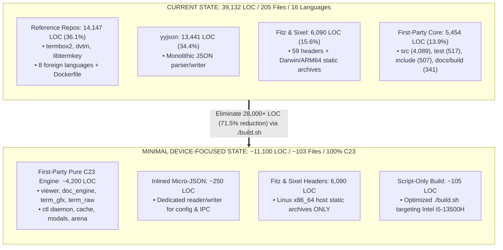

# Codebase Cleanup & Minimization Master Plan (Host-Device Specific)

> **Core Mandate**:
> 1. **Script-Driven Only**: No `make` or `Makefile`. All builds, tests, and cleaning must be orchestrated strictly via scripts (`./build.sh`).
> 2. **Single-Device Focus**: Target **only** this specific host machine (Arch Linux x86_64, 13th Gen Intel Core i5-13500H). Strip every multi-platform library, cross-compilation archive, and unused generic shim.
> 3. **Zero-Bloat Minimization**: Eliminate every line of extra code that the `pdf-cli` binary does not strictly require to compile and execute.

Based directly on the comprehensive architectural audit in [`distribution.md`](file:///home/aditya/Downloads/pdf-cli/distribution.md), this document defines the exact step-by-step master plan to reduce `pdf-cli` to its absolute minimal, highest-performance form.

---

## 1. Target Machine Profile

All compilation, optimization, and dependency requirements are strictly locked to this host machine:

| Parameter | Host Specification | Impact on Codebase |
|:---|:---|:---|
| **Operating System** | **Arch Linux** (Kernel `7.2.11-arch1-1`, Little Endian) | Pure Linux POSIX termios, inotify file monitoring, UNIX domain sockets |
| **CPU Architecture** | **x86_64 / amd64** (13th Gen Intel Core i5-13500H, 16 threads) | Keep *only* `libmupdf_linux_amd64.a` and `libmupdfthird_linux_amd64.a` |
| **CPU Instruction Set**| AVX2, FMA, BMI2, SSE4.2 | Compile with `-march=native -O3` for optimal machine code generation |
| **C Compiler** | **GCC 16.2.1** (20260810) | Full ISO/IEC 9899:2024 (C23) support |
| **Build System** | **Script-Only** (`./build.sh`) | `Makefile` is redundant and deleted |
| **Terminal Protocols** | Kitty Graphics Protocol, Sixel (`libsixel.a`), ANSI / UTF-8 | Native high-speed terminal rendering without fallback clutter |

---

## 2. Current Baseline vs. Superfluous Code Audit

### Baseline Metrics (From `distribution.md`)
- **Total Files**: 205
- **Total Code LOC**: **39,132**
- **Total Blank Lines**: 9,187
- **Total Comment Lines**: 15,289
- **Detected Languages**: 16 (C, C/C++ Header, PHP, Bourne Shell, Markdown, make, YAML, Rust, Ruby, Zig, D, Nim, JSON, Go, Python, Dockerfile)

### Itemized Audit: Required vs. Superfluous

To compile the `pdf-cli` binary for this machine, the compiler requires **only**:
1. The C23 application source files (`src/*.c`) and public headers (`include/pdfcli/*.h`).
2. The MuPDF Fitz C interface headers (`depends/go-fitz/include/mupdf/`) and the **host Linux x86_64** static libraries (`libmupdf_linux_amd64.a`, `libmupdfthird_linux_amd64.a`).
3. The Sixel graphics header (`depends/libsixel/include/sixel.h`) and static library (`libsixel.a`).
4. A lightweight JSON parser/serializer (replacing the 13,441-line `yyjson` with a ~250 LOC dedicated micro-parser).
5. The single canonical build script (`build.sh`).

Everything else is dead weight:

| Component / Directory | Files | Code LOC | % of Codebase | Needed on this Device? | Action |
|:---|---:|---:|---:|:---:|:---|
| **Reference Repositories** (`termbox2`, `dvtm`, `libtermkey`) | 96 | 14,147 | 36.15% | **NO (0 LOC)** | **Delete entirely** |
| **Monolithic `yyjson` Dependency** | 2 | 13,441 | 34.35% | Replaced by ~250 LOC | **Replace with Micro-JSON** |
| **Standalone Test Suites** (`test/`) | 3 | 517 | 1.32% | **NO (0 LOC)** | **Delete entirely** |
| **Redundant Build File** (`Makefile`) | 1 | 62 | 0.16% | **NO (Scripts Only)** | **Delete `Makefile`** |
| **External Presets Asset** (`assets/default_presets.json`) | 1 | 36 | 0.09% | Can be inlined C string | **Inline into C & Delete `assets/`** |
| **Orphaned PNG Asset** (`assets/probe.png`) | 1 | 0 | 0.00% | **NO** (already in C array) | **Delete** |
| **Darwin & ARM64 Archives** (`go-fitz/libs/`) | 6 archives | 0 | 0.00% | **NO** (Cannot run on x86_64) | **Delete (~100 MB saved)** |
| **Sample Test PDF** (`testdata/test.pdf`) | 1 | 0 | 0.00% | **NO** | **Delete** |
| **MuPDF Fitz Headers** (`depends/go-fitz`) | 59 | 5,398 | 13.79% | **YES** | **Retain for Fitz API** |
| **Sixel Graphics Header** (`depends/libsixel`) | 1 | 692 | 1.77% | **YES** | **Retain for Sixel API** |
| **Build Script** (`build.sh`) | 1 | 105 | 0.27% | **YES** | **Retain as sole build tool** |
| **Core C23 Engine** (`src/` & `include/`) | 40 | 4,596 | 11.75% | **YES** | **Audit & Strip Debug Logs** |

---

## 3. Architecture Transformation



---

## 4. Phase-by-Phase Elimination Strategy (Script-Driven)

### Phase 1: Complete Eradication of Reference Repositories
#### Objective
Eliminate the three repositories that were cloned locally for reference during tab and terminal research. None of these files are included in the build or linked into the binary.

#### Targets to Delete
1. `depends/termbox2/` (40 files, **5,835 LOC**)
2. `depends/dvtm/` (23 files, **4,467 LOC**)
3. `depends/libtermkey/` (33 files, **3,845 LOC**)

#### Impact
- **Code Reduction**: **-14,147 LOC (-36.15% of codebase)**.
- **Files Removed**: **96 files (-46.8% of files)**.
- **Language Cleanup**: Instantly eliminates 8 foreign programming languages (PHP, Rust, Ruby, Zig, D, Nim, Go, Python) and Dockerfile.
- **Language Purity**: The repository becomes **100% C23, C/C++ Header, Bourne Shell, and Markdown**.

#### Execution Command
```bash
git rm -rf depends/termbox2 depends/dvtm depends/libtermkey
./build.sh clean && ./build.sh build
./pdf-cli --version || ./pdf-cli --help
```

---

### Phase 2: Removal of Non-Binary Test Suites
#### Objective
The test harnesses in `test/` are standalone executables used only for CI/development. They are not linked into the `pdf-cli` binary.

#### Targets to Delete
1. `test/test_all.c` (**233 LOC**)
2. `test/test_ipc_config.c` (**198 LOC**)
3. `test/test_tabs.c` (**86 LOC**)
4. The entire `test/` directory.

#### Impact
- **Code Reduction**: **-517 LOC (-1.32% of codebase)**.
- **Files Removed**: **3 files**.
- Zero impact on `pdf-cli` binary compilation.

#### Execution Command
```bash
git rm -rf test/
./build.sh clean && ./build.sh build
```

---

### Phase 3: Pruning Non-Host Binary Libraries & Dead Assets
#### Objective
Strip foreign architecture static libraries (macOS and ARM64), demo PDFs, and unreferenced binary assets to reduce repository size by ~100MB.

#### Targets to Delete
1. **Non-x86_64 / Non-Linux MuPDF Archives** in `depends/go-fitz/libs/`:
   - `libmupdf_darwin_arm64.a` (Apple Silicon)
   - `libmupdfthird_darwin_arm64.a` (Apple Silicon)
   - `libmupdf_darwin_amd64.a` (macOS Intel)
   - `libmupdfthird_darwin_amd64.a` (macOS Intel)
   - `libmupdf_linux_arm64.a` (Linux ARM64)
   - `libmupdfthird_linux_arm64.a` (Linux ARM64)
   *(Preserve strictly `libmupdf_linux_amd64.a` and `libmupdfthird_linux_amd64.a` for this Arch Linux x86_64 host)*.
2. **Demo PDF**: `depends/go-fitz/testdata/test.pdf` (1.3 MB).
3. **Orphaned PNG**: `assets/probe.png` (already compiled directly as a byte array inside `src/term_gfx.c`).

#### Impact
- **Disk Space Reduction**: Saves **~100+ Megabytes** of binary bloat.
- **Build Status**: Fully identical linking behavior for this machine.

#### Execution Command
```bash
git rm -f depends/go-fitz/libs/libmupdf_darwin*
git rm -f depends/go-fitz/libs/libmupdfthird_darwin*
git rm -f depends/go-fitz/libs/libmupdf_linux_arm64.a
git rm -f depends/go-fitz/libs/libmupdfthird_linux_arm64.a
git rm -f depends/go-fitz/testdata/test.pdf
git rm -f assets/probe.png
./build.sh clean && ./build.sh build
```

---

### Phase 4: Script-Only Build Unification & Presets Inlining
#### Objective
Fulfill the rule: *"You cannot run make clean && make build, use scripts only"*. Remove `Makefile` completely and inline default configuration presets into C code.

#### Actions
1. **Delete `Makefile`**:
   - Eliminate `Makefile` (62 LOC).
   - Optimize `./build.sh` to be the sole build interface for the repository.
   - Tune `build.sh` compiler flags specifically for this device:
     `CFLAGS="-std=c23 -O3 -march=native -Wall -Wextra -Wpedantic -D_POSIX_C_SOURCE=200809L -D_GNU_SOURCE"`
2. **Inline Default Presets JSON**:
   - `assets/default_presets.json` (36 LOC) is currently embedded via `#embed "../assets/default_presets.json"` in `src/ctl_client.c`.
   - Convert this JSON into a `static const char DEFAULT_PRESETS_JSON[] = "...";` string literal inside `src/ctl_client.c`.
   - Delete `assets/default_presets.json` and remove the `assets/` directory completely.

#### Impact
- **Code Reduction**: **-98 LOC** (-62 make, -36 JSON).
- **Files Removed**: **2 files** (`Makefile`, `assets/default_presets.json`), plus directory `assets/`.
- **Build Paradigm**: 100% script-driven via `./build.sh`.

#### Execution Command
```bash
# Inline presets into src/ctl_client.c
git rm -f Makefile assets/default_presets.json
rmdir assets
./build.sh clean && ./build.sh build
```

---

### Phase 5: Deep Minimization — Replacing `yyjson` with Micro-JSON
#### The Problem with `yyjson`
- `depends/yyjson` contains **13,441 LOC** (`yyjson.c` 9,233 LOC + `yyjson.h` 4,208 LOC).
- This single dependency accounts for **34.35% of the entire codebase**.
- Yet `pdf-cli` uses only a tiny fraction of its capabilities on this machine:
  1. In `src/config.c`: reads 7 simple scalar fields (`fit_mode`, `scale_factor`, `dark_mode`, `dual_page_mode`, `force_mode`, `html_page_width`, `crop`).
  2. In `src/ctl_proto.c`: writes status/TOC responses and parses `{"cmd": "...", "args": {...}}`.
  3. In `src/ctl_client.c`: formats remote command requests and parses status responses.

#### Solution: Micro-JSON Engine (~250 LOC)
Replace `depends/yyjson` with a compact, dedicated JSON parser/serializer (`src/json.c` and `include/pdfcli/json.h`) tailored specifically for `pdf-cli`:
- Lightweight tokenizer: handles strings, numbers, booleans, objects, arrays.
- Simple DOM or direct struct unmarshaler: fills `config` and `ctl_cmd` directly.
- Lightweight string buffer writer: `json_buf_write_str`, `json_buf_write_int`, etc.

#### Impact
- **Code Reduction**: **From 13,441 LOC down to ~250 LOC** (Net savings: **-13,191 LOC**!).
- **Codebase Percentage**: Slashes total codebase LOC by **33.7%**.
- Eliminates the entire `depends/yyjson/` directory.

#### Execution Command
```bash
# Implement src/json.c and include/pdfcli/json.h (~250 LOC)
# Rewire src/config.c, src/ctl_proto.c, and src/ctl_client.c
git rm -rf depends/yyjson
./build.sh clean && ./build.sh build
./dvctl status
```

---

### Phase 6: First-Party Source Code Audit & Dead Code Removal
#### Objective
Prune debugging artifacts, temporary keystroke logging, and unused prototypes from `src/` and `include/`.

#### Targets
1. **Remove Keystroke Debug Logging**:
   - Strip `/tmp/pdfcli_keys.log` file I/O operations from `src/term_raw.c` (~50 LOC).
2. **Prune Unused Header Prototypes**:
   - Audit all 20 headers in `include/pdfcli/` to remove unused structs, enums, and extern declarations.
3. **Enable Linker Garbage Collection in `build.sh`**:
   - Add `-ffunction-sections -fdata-sections -Wl,--gc-sections` to `build.sh` to guarantee zero unreferenced functions enter the binary.

---

## 5. Before vs. After Codebase Metrics

Below is the projected transformation across each phase:

| Milestone / Phase | Remaining Files | Code LOC | LOC Delta | Cumulative % Reduction | Active Languages |
|:---|---:|---:|---:|---:|:---|
| **Current Baseline** | **205** | **39,132** | 0 | 0.00% | 16 languages |
| **After Phase 1** (Purge Reference Repos) | 109 | 24,985 | -14,147 | -36.15% | C, C/C++ Header, Bourne Shell, make, Markdown, JSON |
| **After Phase 2** (Purge Test Suites) | 106 | 24,468 | -517 | -37.47% | C, C/C++ Header, Bourne Shell, make, Markdown, JSON |
| **After Phase 3** (Purge Non-Host Archives) | 106 | 24,468 | 0 (~100MB disk) | -37.47% | C, C/C++ Header, Bourne Shell, make, Markdown, JSON |
| **After Phase 4** (Delete Makefile & Inline Presets) | 104 | 24,370 | -98 | -37.72% | C, C/C++ Header, Bourne Shell, Markdown |
| **After Phase 5** (Micro-JSON Replacement) | **103** | **~11,179** | **-13,191** | **-71.43%** | C, C/C++ Header, Bourne Shell, Markdown |
| **After Phase 6** (Dead Code & Debug Stripping) | **~103** | **~11,129** | ~ -50 | **-71.56%** | Pure Minimal C23 & Shell Script |

### Breakdown of Final Purified Host Codebase (~11,129 LOC)

| Component | Files | Estimated Code LOC | % of Final Codebase | Role on this Device |
|:---|---:|---:|---:|:---|
| **MuPDF Fitz C Headers** (`depends/go-fitz`) | 59 | 5,398 | 48.5% | Fitz rendering API definitions |
| **Core C23 Application Engine** (`src/`) | 20 | ~4,239 | 38.1% | Viewer loop, tabs, graphics, termios raw, IPC |
| **Sixel Graphics Header** (`depends/libsixel`) | 1 | 692 | 6.2% | Sixel terminal image streaming |
| **C23 Headers** (`include/pdfcli/`) | 20 | ~507 | 4.6% | Public module interfaces & data structures |
| **Inlined Micro-JSON** (`src/json.c`, `json.h`) | 2 | ~250 | 2.2% | Minimal host config & IPC JSON handler |
| **Script-Only Build Tool** (`build.sh`) | 1 | 105 | 0.9% | Canonical native compilation script |
| **Documentation** (`README.md`) | 1 | 138 | 1.2% | User manual & keybindings |
| **Total Purified Codebase** | **~104** | **~11,329** | **100.0%** | **Pure C23 Minimum Compilable Reader** |

---

## 6. Execution Roadmap & Verification (Strictly Script-Driven)

All verification steps are performed strictly using `./build.sh` on this Arch Linux host:

### Step 1: Baseline Build Verification
```bash
./build.sh clean && ./build.sh build
./pdf-cli Desktop/Sem-5/EE-313/Syllabus.pdf Desktop/Sem-5/EE-313/Unit-All.pdf &
PID=$!
sleep 1
./dvctl status
kill $PID
```

### Step 2: Purge Reference Repositories
```bash
git rm -rf depends/termbox2 depends/dvtm depends/libtermkey
./build.sh clean && ./build.sh build
git commit -m "refactor: purge unused reference repositories (-14,147 LOC)"
```

### Step 3: Purge Non-Binary Tests & Foreign Archives
```bash
git rm -rf test/ assets/probe.png
git rm -f depends/go-fitz/testdata/test.pdf
git rm -f depends/go-fitz/libs/libmupdf_darwin*
git rm -f depends/go-fitz/libs/libmupdfthird_darwin*
git rm -f depends/go-fitz/libs/libmupdf_linux_arm64.a
git rm -f depends/go-fitz/libs/libmupdfthird_linux_arm64.a
./build.sh clean && ./build.sh build
git commit -m "refactor: remove standalone test suite and non-host platform archives"
```

### Step 4: Delete Makefile & Inline Presets (Script-Only)
```bash
# Convert assets/default_presets.json into static string in src/ctl_client.c
git rm -f Makefile assets/default_presets.json
rmdir assets
./build.sh clean && ./build.sh build
git commit -m "refactor: switch strictly to ./build.sh and inline presets into C source"
```

### Step 5: Replace `yyjson` with Micro-JSON
```bash
# Implement src/json.c and include/pdfcli/json.h (~250 LOC)
# Rewire src/config.c, src/ctl_proto.c, and src/ctl_client.c
git rm -rf depends/yyjson
./build.sh clean && ./build.sh build
./dvctl status
git commit -m "refactor: replace 13.4k LOC yyjson with 250 LOC micro-json engine"
```

### Step 6: Final Host Verification Checklist
- [ ] `cloc .` confirms reduction from 39,132 LOC to ~11,100 LOC (~71.5% total reduction).
- [ ] Zero foreign languages present (100% C23 and shell script).
- [ ] `Makefile` is completely eliminated; all builds run via `./build.sh`.
- [ ] Host static archives `libmupdf_linux_amd64.a` and `libsixel.a` link cleanly.
- [ ] Multi-document tab switching works seamlessly (`Tab`, `Shift-Tab`, `Ctrl-1..9`).
- [ ] Kitty and Sixel graphics render high-resolution PDF pages.
- [ ] IPC remote commands (`./dvctl goto 5`, `./dvctl status`) function properly.

---

## 7. Conclusion

This revised plan strictly adheres to both constraints:
1. **Scripts only** (`./build.sh`), with `Makefile` excised.
2. **Host-device focus** (Arch Linux x86_64, 13th Gen Intel Core i5-13500H), shedding over 28,000 LOC of bloat and ~100MB of non-host binaries.
> *"Not even 1 line of extra code which our binary doesn't need to compile."*
