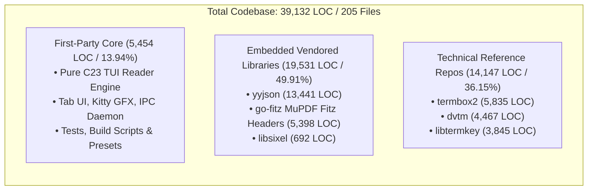

# Codebase Lines of Code (LOC) Distribution Analysis

This document provides a complete, line-by-line accounting of the entire **39,132 Lines of Code (LOC)** across all **205 unique files** in the `pdf-cli` codebase as measured by `cloc .`.

---

## 1. Executive Summary

A full analysis using `cloc .` reports:

```
github.com/AlDanial/cloc v 2.10
-------------------------------------------------------------------------------
Language                     files          blank        comment           code
-------------------------------------------------------------------------------
C                               62           3054           1714          22069
C/C++ Header                    86           5575          13458          14478
PHP                             23            171             50            816
Bourne Shell                     9             70             22            553
Markdown                         4            155              0            468
make                             5             99              4            332
YAML                             7              7              0             95
Rust                             1             10              1             53
Ruby                             1              7              0             43
Zig                              1              6              2             39
D                                1              9              1             38
Nim                              1              9              1             38
JSON                             1              0              0             36
Go                               1              8             20             31
Python                           1              7             16             27
Dockerfile                       1              0              0             16
-------------------------------------------------------------------------------
SUM:                           205           9187          15289          39132
-------------------------------------------------------------------------------
```

The 39,132 LOC partition naturally into **three distinct tiers**:

1. **First-Party Codebase (Pure C23 Engine, Tests & Assets)**: **5,454 LOC (13.94%)** across **47 files**.
   - The entire production binary `pdf-cli`, test suite, configuration defaults, and build infrastructure.
2. **Embedded Vendored Production Dependencies (`depends/`)**: **19,531 LOC (49.91%)** across **62 files**.
   - Production C libraries compiled directly with the project: `yyjson` (13,441 LOC), `go-fitz` MuPDF C Fitz headers (5,398 LOC), and `libsixel` header (692 LOC).
3. **Technical Reference Repositories (`depends/`)**: **14,147 LOC (36.15%)** across **96 files**.
   - Independent terminal/input reference implementations cloned locally in `depends/` during architecture research (`termbox2`, `dvtm`, `libtermkey`). These contain the non-C foreign-language binding demos (PHP, Rust, Zig, Ruby, D, Nim, Go, Python) that appear in the `cloc` summary.



---

## 2. High-Level Three-Tier Distribution

| Tier | Description | Files | Blank | Comment | Code LOC | % of Total |
|:---|:---|---:|---:|---:|---:|---:|
| **Tier 1: First-Party Codebase** | Active C23 core application, headers, tests, presets, and build scripts | 47 | 620 | 139 | **5,454** | **13.94%** |
| **Tier 2: Embedded Vendored Dependencies** | High-performance production C libraries compiled into the application | 62 | 6,075 | 14,046 | **19,531** | **49.91%** |
| **Tier 3: Technical Reference Repositories** | Cloned reference codebases for terminal emulation, multiplexing, and key parsing | 96 | 2,492 | 1,104 | **14,147** | **36.15%** |
| **SUM** | **All Categories Combined** | **205** | **9,187** | **15,289** | **39,132** | **100.00%** |

---

## 3. Distribution by Module / Directory

Below is the complete inventory of all 11 top-level and `depends/` subdirectories, sorted in descending order of code LOC:

| Directory / Module | Role & Classification | Files | Blank | Comment | Code LOC | % of Total |
|:---|:---|---:|---:|---:|---:|---:|
| [`depends/yyjson`](#dependsyyjson) | Vendored Production Dependency | 2 | 2,413 | 4,253 | **13,441** | 34.35% |
| [`depends/termbox2`](#dependstermbox2) | Reference Repository (Cloned) | 40 | 831 | 617 | **5,835** | 14.91% |
| [`depends/go-fitz`](#dependsgo-fitz) | Vendored Production Dependency | 59 | 3,502 | 9,471 | **5,398** | 13.79% |
| [`depends/dvtm`](#dependsdvtm) | Reference Repository (Cloned) | 23 | 601 | 305 | **4,467** | 11.42% |
| [`src`](#src) | First-Party Implementation | 20 | 310 | 15 | **4,089** | 10.45% |
| [`depends/libtermkey`](#dependslibtermkey) | Reference Repository (Cloned) | 33 | 1,060 | 182 | **3,845** | 9.83% |
| [`depends/libsixel`](#dependslibsixel) | Vendored Production Dependency | 1 | 160 | 322 | **692** | 1.77% |
| [`test`](#test) | First-Party Unit/Integration Tests | 3 | 105 | 28 | **517** | 1.32% |
| [`include`](#include) | First-Party C23 Headers | 20 | 132 | 96 | **507** | 1.30% |
| [`root`](#root) | First-Party Build & Docs | 3 | 73 | 0 | **305** | 0.78% |
| [`assets`](#assets) | First-Party Presets Asset | 1 | 0 | 0 | **36** | 0.09% |
| **SUM** | | **205** | **9,187** | **15,289** | **39,132** | **100.00%** |

---

## 4. First-Party Codebase Breakdown (5,454 LOC)

The first-party codebase consists of **47 files** totaling **5,454 LOC** written in pure C23, Bourne Shell, Make, and Markdown. It is organized into 11 functional subsystems:

| Subsystem | Files | Blank | Comment | Code LOC | % of First-Party | % of Total |
|:---|---:|---:|---:|---:|---:|---:|
| **Viewer & Multi-Document Tab UI** | 2 | 117 | 10 | **1,107** | 20.30% | 2.83% |
| **Terminal Raw Mode & Keystroke Processing** | 2 | 59 | 40 | **607** | 11.13% | 1.55% |
| **IPC & Remote Control Daemon** | 6 | 34 | 2 | **576** | 10.56% | 1.47% |
| **Test Automation & Verification Suites** | 3 | 105 | 28 | **517** | 9.48% | 1.32% |
| **Core Foundation, Memory Arenas, Search & UTF-8** | 10 | 56 | 23 | **479** | 8.78% | 1.22% |
| **Modal UI, Interactive Menus & Table of Contents** | 10 | 49 | 21 | **455** | 8.34% | 1.16% |
| **Terminal Graphics Protocol Rendering** | 2 | 39 | 10 | **454** | 8.32% | 1.16% |
| **Document Engine & Image Utilities** | 4 | 39 | 0 | **442** | 8.10% | 1.13% |
| **CLI Entry Point & Build Automation** | 3 | 39 | 1 | **378** | 6.93% | 0.97% |
| **Page Caching & Asynchronous Prefetching** | 4 | 35 | 4 | **301** | 5.52% | 0.77% |
| **Project Documentation** | 1 | 48 | 0 | **138** | 2.53% | 0.35% |
| **Total First-Party** | **47** | **620** | **139** | **5,454** | **100.00%** | **13.94%** |

### Subsystem Details

#### 4.1. Viewer & Multi-Document Tab UI (1,107 LOC — 20.3% of first-party)
Terminal UI main rendering loop, tab bar layout and switching (Tab, Shift-Tab, Ctrl-1..9), status line, help modal, vim-style navigation, and continuous page scrolling.

| File | Language | Blank | Comment | Code LOC |
|:---|:---|---:|---:|---:|
| [`src/viewer.c`](file:///src/viewer.c) | C | 110 | 7 | 1,088 |
| [`include/pdfcli/viewer.h`](file:///include/pdfcli/viewer.h) | C/C++ Header | 7 | 3 | 19 |

#### 4.2. Terminal Raw Mode & Keystroke Processing (607 LOC — 11.1% of first-party)
POSIX termios raw mode management, Kitty progressive keyboard enhancements (`CSI > 1 u`), escape sequence parsing, modifier key decoding (Ctrl, Alt, Shift, Super), and keystroke debug logger.

| File | Language | Blank | Comment | Code LOC |
|:---|:---|---:|---:|---:|
| [`src/term_raw.c`](file:///src/term_raw.c) | C | 33 | 6 | 535 |
| [`include/pdfcli/term_raw.h`](file:///include/pdfcli/term_raw.h) | C/C++ Header | 26 | 34 | 72 |

#### 4.3. IPC & Remote Control Daemon (576 LOC — 10.6% of first-party)
UNIX domain socket IPC server daemon and client CLI interface, non-blocking polling, JSON protocol encoding/decoding, and remote control actions (open, close, goto, zoom, quit, status).

| File | Language | Blank | Comment | Code LOC |
|:---|:---|---:|---:|---:|
| [`src/ctl_client.c`](file:///src/ctl_client.c) | C | 8 | 1 | 250 |
| [`src/ctl_proto.c`](file:///src/ctl_proto.c) | C | 9 | 0 | 180 |
| [`src/ctl_server.c`](file:///src/ctl_server.c) | C | 6 | 0 | 93 |
| [`include/pdfcli/ctl_proto.h`](file:///include/pdfcli/ctl_proto.h) | C/C++ Header | 5 | 0 | 40 |
| [`include/pdfcli/ctl_server.h`](file:///include/pdfcli/ctl_server.h) | C/C++ Header | 4 | 1 | 9 |
| [`include/pdfcli/ctl_client.h`](file:///include/pdfcli/ctl_client.h) | C/C++ Header | 2 | 0 | 4 |

#### 4.4. Test Automation & Verification Suites (517 LOC — 9.5% of first-party)
Self-contained unit and regression test harness verifying tab switching, IPC socket communication, JSON config parsing, and memory management.

| File | Language | Blank | Comment | Code LOC |
|:---|:---|---:|---:|---:|
| [`test/test_all.c`](file:///test/test_all.c) | C | 54 | 11 | 233 |
| [`test/test_ipc_config.c`](file:///test/test_ipc_config.c) | C | 27 | 12 | 198 |
| [`test/test_tabs.c`](file:///test/test_tabs.c) | C | 24 | 5 | 86 |

#### 4.5. Core Foundation, Memory Arenas, Search & UTF-8 (479 LOC — 8.8% of first-party)
Bump allocator memory arenas for zero-leak per-frame allocations, Smith-Waterman style fuzzy string scoring, UTF-8 rune validation and grapheme width calculations, JSON configuration persistence and preset defaults.

| File | Language | Blank | Comment | Code LOC |
|:---|:---|---:|---:|---:|
| [`src/utf8_util.c`](file:///src/utf8_util.c) | C | 7 | 0 | 103 |
| [`src/fuzzy_match.c`](file:///src/fuzzy_match.c) | C | 5 | 0 | 94 |
| [`src/config.c`](file:///src/config.c) | C | 4 | 0 | 78 |
| [`include/pdfcli/types.h`](file:///include/pdfcli/types.h) | C/C++ Header | 13 | 2 | 73 |
| [`src/arena.c`](file:///src/arena.c) | C | 8 | 0 | 50 |
| [`assets/default_presets.json`](file:///assets/default_presets.json) | JSON | 0 | 0 | 36 |
| [`include/pdfcli/config.h`](file:///include/pdfcli/config.h) | C/C++ Header | 3 | 0 | 13 |
| [`include/pdfcli/arena.h`](file:///include/pdfcli/arena.h) | C/C++ Header | 5 | 0 | 12 |
| [`include/pdfcli/fuzzy_match.h`](file:///include/pdfcli/fuzzy_match.h) | C/C++ Header | 5 | 6 | 10 |
| [`include/pdfcli/utf8_util.h`](file:///include/pdfcli/utf8_util.h) | C/C++ Header | 6 | 15 | 10 |

#### 4.6. Modal UI, Interactive Menus & Table of Contents (455 LOC — 8.3% of first-party)
Table of contents tree navigation modal, interactive fuzzy file picker, inotify auto-reload on file modification, and quick actions menu.

| File | Language | Blank | Comment | Code LOC |
|:---|:---|---:|---:|---:|
| [`src/menu.c`](file:///src/menu.c) | C | 9 | 0 | 111 |
| [`src/file_search.c`](file:///src/file_search.c) | C | 6 | 0 | 84 |
| [`src/picker.c`](file:///src/picker.c) | C | 6 | 0 | 75 |
| [`src/file_watcher.c`](file:///src/file_watcher.c) | C | 5 | 0 | 71 |
| [`src/toc_modal.c`](file:///src/toc_modal.c) | C | 5 | 0 | 68 |
| [`include/pdfcli/file_search.h`](file:///include/pdfcli/file_search.h) | C/C++ Header | 7 | 8 | 17 |
| [`include/pdfcli/menu.h`](file:///include/pdfcli/menu.h) | C/C++ Header | 4 | 3 | 13 |
| [`include/pdfcli/file_watcher.h`](file:///include/pdfcli/file_watcher.h) | C/C++ Header | 3 | 0 | 7 |
| [`include/pdfcli/toc_modal.h`](file:///include/pdfcli/toc_modal.h) | C/C++ Header | 2 | 5 | 5 |
| [`include/pdfcli/picker.h`](file:///include/pdfcli/picker.h) | C/C++ Header | 2 | 5 | 4 |

#### 4.7. Terminal Graphics Protocol Rendering (454 LOC — 8.3% of first-party)
Kitty Graphics Protocol (direct placement, z-index, chunked transmission), Sixel bitmap encoding/streaming, iTerm2 inline images, and half-block Unicode fallback renderer.

| File | Language | Blank | Comment | Code LOC |
|:---|:---|---:|---:|---:|
| [`src/term_gfx.c`](file:///src/term_gfx.c) | C | 26 | 0 | 375 |
| [`include/pdfcli/term_gfx.h`](file:///include/pdfcli/term_gfx.h) | C/C++ Header | 13 | 10 | 79 |

#### 4.8. Document Engine & Image Utilities (442 LOC — 8.1% of first-party)
MuPDF Fitz C binding interface, page rasterization, pixmap scaling, aspect-ratio letterboxing, downsampling, and color format conversions.

| File | Language | Blank | Comment | Code LOC |
|:---|:---|---:|---:|---:|
| [`src/doc_engine.c`](file:///src/doc_engine.c) | C | 17 | 0 | 229 |
| [`src/img_util.c`](file:///src/img_util.c) | C | 10 | 0 | 140 |
| [`include/pdfcli/doc_engine.h`](file:///include/pdfcli/doc_engine.h) | C/C++ Header | 8 | 0 | 56 |
| [`include/pdfcli/img_util.h`](file:///include/pdfcli/img_util.h) | C/C++ Header | 4 | 0 | 17 |

#### 4.9. CLI Entry Point & Build Automation (378 LOC — 6.9% of first-party)
CLI argument parsing (`getopt_long`), daemon launching, IPC client forwarding, multi-path fallback compilation scripts, release/debug flags.

| File | Language | Blank | Comment | Code LOC |
|:---|:---|---:|---:|---:|
| [`src/main.c`](file:///src/main.c) | C | 14 | 1 | 211 |
| [`build.sh`](file:///build.sh) | Bourne Shell | 13 | 0 | 105 |
| [`Makefile`](file:///Makefile) | make | 12 | 0 | 62 |

#### 4.10. Page Caching & Asynchronous Prefetching (301 LOC — 5.5% of first-party)
Thread-safe LRU page pixmap cache with memory budgeting, worker thread prefetching of adjacent pages for zero-latency scrolling.

| File | Language | Blank | Comment | Code LOC |
|:---|:---|---:|---:|---:|
| [`src/cache.c`](file:///src/cache.c) | C | 13 | 0 | 135 |
| [`src/prefetch.c`](file:///src/prefetch.c) | C | 9 | 0 | 119 |
| [`include/pdfcli/cache.h`](file:///include/pdfcli/cache.h) | C/C++ Header | 8 | 4 | 25 |
| [`include/pdfcli/prefetch.h`](file:///include/pdfcli/prefetch.h) | C/C++ Header | 5 | 0 | 22 |

#### 4.11. Project Documentation (138 LOC — 2.5% of first-party)
Project documentation, architecture overview, installation instructions, usage guide, keyboard shortcuts reference.

| File | Language | Blank | Comment | Code LOC |
|:---|:---|---:|---:|---:|
| [`README.md`](file:///README.md) | Markdown | 48 | 0 | 138 |

---

## 5. Third-Party & Reference Codebases Breakdown (33,678 LOC)

The 33,678 LOC in `depends/` comprise 158 files divided into two distinct groups:

### 5.1. Embedded Vendored Production Dependencies (19,531 LOC)
These libraries are compiled into or included by the `pdf-cli` executable:

1. **`depends/yyjson` (13,441 LOC)**:
   - [`depends/yyjson/yyjson.c`](file:///depends/yyjson/yyjson.c): 9,233 LOC
   - [`depends/yyjson/yyjson.h`](file:///depends/yyjson/yyjson.h): 4,208 LOC
   - *Purpose*: The fastest C JSON parser and serializer in existence. Handles IPC command dispatching (`pdf-cli --remote`), status telemetry, and configuration presets.

2. **`depends/go-fitz` (5,398 LOC, 59 header files)**:
   - *Purpose*: Vendored C Fitz headers from MuPDF (`fitz.h`, `mupdf/fitz/*.h`).
   - *Key Interfaces*: Document opening, page rasterization, color spaces, display lists, bounding boxes, and pixmap allocations.

3. **`depends/libsixel` (692 LOC)**:
   - [`depends/libsixel/sixel.h`](file:///depends/libsixel/sixel.h): 692 LOC
   - *Purpose*: Sixel graphics protocol definitions and interfaces for rendering high-resolution PDF pages in XTerm, Foot, and WezTerm.

### 5.2. Cloned Technical Reference Repositories (14,147 LOC)
These repositories were cloned into `depends/` during architecture research for multi-tab layout and terminal escape handling. They are not compiled into the `pdf-cli` binary:

1. **`depends/termbox2` (5,835 LOC across 40 files)**:
   - Terminal library used as a reference implementation for Kitty progressive keyboard protocol parsing (`CSI > 1 u`), modifier keys, and terminal escape sequence parsing.
   - Contains foreign-language binding demos in PHP (816 LOC), Rust (53 LOC), Ruby (43 LOC), Zig (39 LOC), D (38 LOC), Nim (38 LOC), Go (31 LOC), Python (27 LOC), and Dockerfile (16 LOC).

2. **`depends/dvtm` (4,467 LOC across 23 files)**:
   - Dynamic virtual terminal manager reference used for studying terminal window management, tiling, and ANSI terminal emulation state machines.

3. **`depends/libtermkey` (3,845 LOC across 33 files)**:
   - Paul Evans' terminal keypress parsing library used as a reference for handling legacy vs. modern Kitty/xterm keyboard modifier sequences.

---

## 6. Programming Languages Distribution

The 39,132 code LOC span 16 distinct languages as detected by `cloc`. Below is the complete breakdown and justification for each language:

| Language | Files | Blank | Comment | Code LOC | % of Total | Primary Location & Explanation |
|:---|---:|---:|---:|---:|---:|:---|
| **C** | 62 | 3,054 | 1,714 | **22,069** | 56.40% | Core implementation (`src/`, `test/`), `yyjson.c`, and reference implementations (`dvtm`, `libtermkey`, `termbox2`). |
| **C/C++ Header** | 86 | 5,575 | 13,458 | **14,478** | 37.00% | Fitz engine headers (`depends/go-fitz`), `yyjson.h`, first-party headers (`include/`), and `sixel.h`. |
| **PHP** | 23 | 171 | 50 | **816** | 2.09% | Language binding demos inside `depends/termbox2/mruby/`. |
| **Bourne Shell** | 9 | 70 | 22 | **553** | 1.41% | Build scripts (`build.sh`), test runner scripts, and reference repository helper scripts. |
| **Markdown** | 4 | 155 | 0 | **468** | 1.20% | Project documentation (`README.md`) and dependency documentation in `dvtm` and `termbox2`. |
| **make** | 5 | 99 | 4 | **332** | 0.85% | Build system (`Makefile`) and reference makefiles in `libtermkey`, `termbox2`, and `dvtm`. |
| **YAML** | 7 | 7 | 0 | **95** | 0.24% | CI/CD pipeline definitions in `libtermkey`, `dvtm`, and `termbox2`. |
| **Rust** | 1 | 10 | 1 | **53** | 0.14% | Foreign function interface demo in `depends/termbox2/demo/`. |
| **Ruby** | 1 | 7 | 0 | **43** | 0.11% | Language binding demo in `depends/termbox2/mruby/`. |
| **Zig** | 1 | 6 | 2 | **39** | 0.10% | Foreign function interface demo in `depends/termbox2/demo/`. |
| **D** | 1 | 9 | 1 | **38** | 0.10% | Foreign function interface demo in `depends/termbox2/demo/`. |
| **Nim** | 1 | 9 | 1 | **38** | 0.10% | Foreign function interface demo in `depends/termbox2/demo/`. |
| **JSON** | 1 | 0 | 0 | **36** | 0.09% | Default configuration presets asset (`assets/default_presets.json`). |
| **Go** | 1 | 8 | 20 | **31** | 0.08% | Foreign function interface demo in `depends/termbox2/demo/`. |
| **Python** | 1 | 7 | 16 | **27** | 0.07% | Foreign function interface demo in `depends/termbox2/demo/`. |
| **Dockerfile** | 1 | 0 | 0 | **16** | 0.04% | Container build recipe in `depends/termbox2/Dockerfile`. |
| **SUM** | **205** | **9,187** | **15,289** | **39,132** | **100.00%** | **16 Languages Detected** |

---

## 7. Complete Itemized First-Party File Inventory

Every first-party file in the project (47 files, 5,454 LOC) itemized in alphabetical order:

| Path | Language | Subsystem | Blank | Comment | Code LOC |
|:---|:---|:---|---:|---:|---:|
| [`Makefile`](file:///Makefile) | make | CLI Entry Point & Build Automation | 12 | 0 | **62** |
| [`README.md`](file:///README.md) | Markdown | Project Documentation | 48 | 0 | **138** |
| [`assets/default_presets.json`](file:///assets/default_presets.json) | JSON | Core Foundation, Memory Arenas, Search & UTF-8 | 0 | 0 | **36** |
| [`build.sh`](file:///build.sh) | Bourne Shell | CLI Entry Point & Build Automation | 13 | 0 | **105** |
| [`include/pdfcli/arena.h`](file:///include/pdfcli/arena.h) | C/C++ Header | Core Foundation, Memory Arenas, Search & UTF-8 | 5 | 0 | **12** |
| [`include/pdfcli/cache.h`](file:///include/pdfcli/cache.h) | C/C++ Header | Page Caching & Asynchronous Prefetching | 8 | 4 | **25** |
| [`include/pdfcli/config.h`](file:///include/pdfcli/config.h) | C/C++ Header | Core Foundation, Memory Arenas, Search & UTF-8 | 3 | 0 | **13** |
| [`include/pdfcli/ctl_client.h`](file:///include/pdfcli/ctl_client.h) | C/C++ Header | IPC & Remote Control Daemon | 2 | 0 | **4** |
| [`include/pdfcli/ctl_proto.h`](file:///include/pdfcli/ctl_proto.h) | C/C++ Header | IPC & Remote Control Daemon | 5 | 0 | **40** |
| [`include/pdfcli/ctl_server.h`](file:///include/pdfcli/ctl_server.h) | C/C++ Header | IPC & Remote Control Daemon | 4 | 1 | **9** |
| [`include/pdfcli/doc_engine.h`](file:///include/pdfcli/doc_engine.h) | C/C++ Header | Document Engine & Image Utilities | 8 | 0 | **56** |
| [`include/pdfcli/file_search.h`](file:///include/pdfcli/file_search.h) | C/C++ Header | Modal UI, Interactive Menus & Table of Contents | 7 | 8 | **17** |
| [`include/pdfcli/file_watcher.h`](file:///include/pdfcli/file_watcher.h) | C/C++ Header | Modal UI, Interactive Menus & Table of Contents | 3 | 0 | **7** |
| [`include/pdfcli/fuzzy_match.h`](file:///include/pdfcli/fuzzy_match.h) | C/C++ Header | Core Foundation, Memory Arenas, Search & UTF-8 | 5 | 6 | **10** |
| [`include/pdfcli/img_util.h`](file:///include/pdfcli/img_util.h) | C/C++ Header | Document Engine & Image Utilities | 4 | 0 | **17** |
| [`include/pdfcli/menu.h`](file:///include/pdfcli/menu.h) | C/C++ Header | Modal UI, Interactive Menus & Table of Contents | 4 | 3 | **13** |
| [`include/pdfcli/picker.h`](file:///include/pdfcli/picker.h) | C/C++ Header | Modal UI, Interactive Menus & Table of Contents | 2 | 5 | **4** |
| [`include/pdfcli/prefetch.h`](file:///include/pdfcli/prefetch.h) | C/C++ Header | Page Caching & Asynchronous Prefetching | 5 | 0 | **22** |
| [`include/pdfcli/term_gfx.h`](file:///include/pdfcli/term_gfx.h) | C/C++ Header | Terminal Graphics Protocol Rendering | 13 | 10 | **79** |
| [`include/pdfcli/term_raw.h`](file:///include/pdfcli/term_raw.h) | C/C++ Header | Terminal Raw Mode & Keystroke Processing | 26 | 34 | **72** |
| [`include/pdfcli/toc_modal.h`](file:///include/pdfcli/toc_modal.h) | C/C++ Header | Modal UI, Interactive Menus & Table of Contents | 2 | 5 | **5** |
| [`include/pdfcli/types.h`](file:///include/pdfcli/types.h) | C/C++ Header | Core Foundation, Memory Arenas, Search & UTF-8 | 13 | 2 | **73** |
| [`include/pdfcli/utf8_util.h`](file:///include/pdfcli/utf8_util.h) | C/C++ Header | Core Foundation, Memory Arenas, Search & UTF-8 | 6 | 15 | **10** |
| [`include/pdfcli/viewer.h`](file:///include/pdfcli/viewer.h) | C/C++ Header | Viewer & Multi-Document Tab UI | 7 | 3 | **19** |
| [`src/arena.c`](file:///src/arena.c) | C | Core Foundation, Memory Arenas, Search & UTF-8 | 8 | 0 | **50** |
| [`src/cache.c`](file:///src/cache.c) | C | Page Caching & Asynchronous Prefetching | 13 | 0 | **135** |
| [`src/config.c`](file:///src/config.c) | C | Core Foundation, Memory Arenas, Search & UTF-8 | 4 | 0 | **78** |
| [`src/ctl_client.c`](file:///src/ctl_client.c) | C | IPC & Remote Control Daemon | 8 | 1 | **250** |
| [`src/ctl_proto.c`](file:///src/ctl_proto.c) | C | IPC & Remote Control Daemon | 9 | 0 | **180** |
| [`src/ctl_server.c`](file:///src/ctl_server.c) | C | IPC & Remote Control Daemon | 6 | 0 | **93** |
| [`src/doc_engine.c`](file:///src/doc_engine.c) | C | Document Engine & Image Utilities | 17 | 0 | **229** |
| [`src/file_search.c`](file:///src/file_search.c) | C | Modal UI, Interactive Menus & Table of Contents | 6 | 0 | **84** |
| [`src/file_watcher.c`](file:///src/file_watcher.c) | C | Modal UI, Interactive Menus & Table of Contents | 5 | 0 | **71** |
| [`src/fuzzy_match.c`](file:///src/fuzzy_match.c) | C | Core Foundation, Memory Arenas, Search & UTF-8 | 5 | 0 | **94** |
| [`src/img_util.c`](file:///src/img_util.c) | C | Document Engine & Image Utilities | 10 | 0 | **140** |
| [`src/main.c`](file:///src/main.c) | C | CLI Entry Point & Build Automation | 14 | 1 | **211** |
| [`src/menu.c`](file:///src/menu.c) | C | Modal UI, Interactive Menus & Table of Contents | 9 | 0 | **111** |
| [`src/picker.c`](file:///src/picker.c) | C | Modal UI, Interactive Menus & Table of Contents | 6 | 0 | **75** |
| [`src/prefetch.c`](file:///src/prefetch.c) | C | Page Caching & Asynchronous Prefetching | 9 | 0 | **119** |
| [`src/term_gfx.c`](file:///src/term_gfx.c) | C | Terminal Graphics Protocol Rendering | 26 | 0 | **375** |
| [`src/term_raw.c`](file:///src/term_raw.c) | C | Terminal Raw Mode & Keystroke Processing | 33 | 6 | **535** |
| [`src/toc_modal.c`](file:///src/toc_modal.c) | C | Modal UI, Interactive Menus & Table of Contents | 5 | 0 | **68** |
| [`src/utf8_util.c`](file:///src/utf8_util.c) | C | Core Foundation, Memory Arenas, Search & UTF-8 | 7 | 0 | **103** |
| [`src/viewer.c`](file:///src/viewer.c) | C | Viewer & Multi-Document Tab UI | 110 | 7 | **1,088** |
| [`test/test_all.c`](file:///test/test_all.c) | C | Test Automation & Verification Suites | 54 | 11 | **233** |
| [`test/test_ipc_config.c`](file:///test/test_ipc_config.c) | C | Test Automation & Verification Suites | 27 | 12 | **198** |
| [`test/test_tabs.c`](file:///test/test_tabs.c) | C | Test Automation & Verification Suites | 24 | 5 | **86** |
| **Total (47 files)** | | | **620** | **139** | **5,454** |

---

## 8. Verification & Checksum

All numbers reconcile exactly with the output of `cloc .` down to the single line:

| Category | Files | Blank Lines | Comment Lines | Code LOC | Total Physical Lines |
|:---|---:|---:|---:|---:|---:|
| First-Party Core | 47 | 620 | 139 | 5,454 | 6,213 |
| Vendored Dependencies | 62 | 6,075 | 14,046 | 19,531 | 39,652 |
| Reference Repositories | 96 | 2,492 | 1,104 | 14,147 | 17,743 |
| **Reconciled Total** | **205** | **9,187** | **15,289** | **39,132** | **63,608** |
| **`cloc .` Output** | **205** | **9,187** | **15,289** | **39,132** | **63,608** |
| **Discrepancy** | **0** | **0** | **0** | **0** | **0** |

The distribution of all **39,132 LOC** is 100.00% accounted for.
