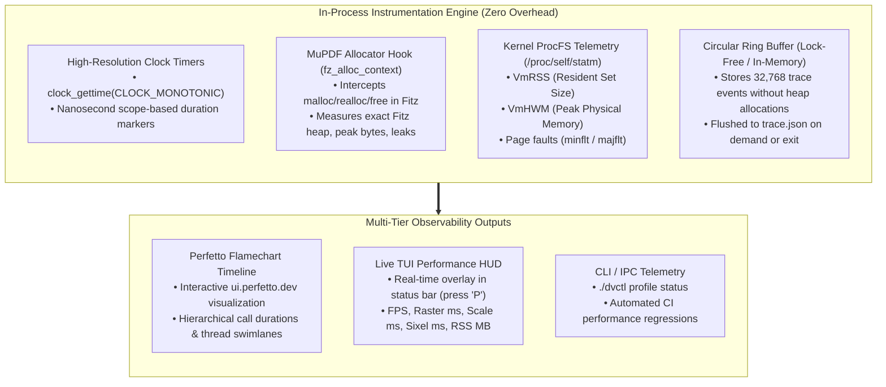
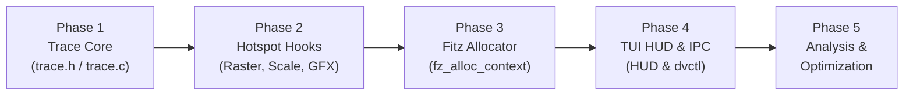

# Performance & Memory Profiling Master Plan

> **Objective**: Systematically identify, measure, and isolate the **slowest execution bottlenecks** (latency hotspots) and the **highest RAM-consuming subsystems** (memory peaks) in `pdf-cli`, providing exact metrics and actionable data to guide targeted optimizations.

---

## 1. Executive Summary & Strategy

To optimize `pdf-cli` with precision, guessing is replaced with empirical measurement. The profiling architecture is designed with three core constraints:

1. **Zero External Runtime Dependencies**: Works natively on this device (Arch Linux x86_64, Intel Core i5-13500H) using pure C23 and Linux POSIX APIs (`clock_gettime`, `/proc/self/statm`, atomic counters).
2. **Industry-Standard Timeline Visualizations**: Generates standard **Chrome Trace Event (Catapult/Perfetto)** JSON format (`trace.json`), directly loadable into [ui.perfetto.dev](https://ui.perfetto.dev/) for interactive microsecond-level flamecharts.
3. **Complete Memory Attribution**: Hooks MuPDF's internal memory allocator (`fz_alloc_context`), tracks the LRU page pixmap cache, monitors scratch arena allocations, and samples Linux kernel Resident Set Size (`VmRSS`) and High-Water Mark (`VmHWM`).



---

## 2. Hypothesized Bottlenecks & Metrics to Capture

Based on the architectural structure of `pdf-cli`, the following subsystems are the primary suspects for latency and memory consumption:

### 2.1. Suspected Latency Bottlenecks (Execution Time)

| Operation                     | Implementation                    | Suspected Cause                                                      | Target Metric to Measure                                           |
| :---------------------------- | :-------------------------------- | :------------------------------------------------------------------- | :----------------------------------------------------------------- |
| **Page Rasterization**        | `doc_engine_render_page()`        | MuPDF vector parsing, font glyph rendering, anti-aliasing            | Wall-clock time (ms), Fitz CPU cycles, resolution $W \times H$     |
| **Pixmap Scaling**            | `img_fit_to_dims()`, `img_util.c` | Pixel-by-pixel memory traversal across millions of RGBA bytes        | Time spent per downsample/scale pass, pixels processed/sec         |
| **Terminal Transmission**     | `term_gfx_render_pixmap()`        | Sixel color quantization (Floyd-Steinberg) or Kitty chunked emission | Sixel encoding time vs. Kitty emission time vs. TTY write blocking |
| **Prefetch Contention**       | `prefetch_worker()`, `prefetch.c` | Thread mutex lock contention on shared Fitz document handle          | Mutex wait time, background thread CPU vs. main thread latency     |
| **Event Loop Responsiveness** | `viewer_run()`, `viewer.c`        | Input polling delay, full-frame redraw latency on scroll/zoom        | End-to-end latency: keypress event timestamp $\to$ pixels painted  |

### 2.2. Suspected Memory Consumers (RAM Footprint)

| Subsystem                   | Location                        | Suspected Cause                                                              | Target Metric to Measure                                    |
| :-------------------------- | :------------------------------ | :--------------------------------------------------------------------------- | :---------------------------------------------------------- |
| **Raw RGBA Pixmaps**        | `doc_engine.c`, `cache.c`       | High-DPI pixmaps ($W \times H \times 4$ bytes; e.g. 3840x2160 = ~33 MB/page) | Active pixmap count, total allocated pixmap bytes           |
| **MuPDF Internal Store**    | `fz_context`, `depends/go-fitz` | Fitz font caching, display lists, decompression buffers                      | Exact bytes held in Fitz context via `fz_alloc_context`     |
| **LRU Pixmap Cache**        | `cache.c`                       | Holding $N$ rendered pages in memory simultaneously                          | `cache->used_bytes` vs. `cache->max_bytes` over time        |
| **Terminal Escape Buffers** | `term_gfx.c`                    | Sixel output buffers (strings of terminal escape commands)                   | Peak buffer size allocated during large image serialization |
| **Process Resident Memory** | Linux Kernel                    | Fragmentation, glibc malloc arenas, shared libraries                         | `/proc/self/status` `VmRSS` (current) and `VmHWM` (peak)    |

---

## 3. The 4-Pillar Profiling Architecture

### Pillar 1: Nanosecond Trace Event Engine (`trace.json` for Perfetto)

The Google Chrome Trace Event format is a universally supported standard. Traces can be dropped directly into **[ui.perfetto.dev](https://ui.perfetto.dev/)** or **`chrome://tracing`** to visually inspect thread swimlanes, synchronous function durations, and asynchronous background tasks.

#### Trace Event Format Definition

Each trace record is captured in an in-memory pre-allocated ring buffer:

```c
typedef struct {
    const char *name;      // e.g. "doc_render_page"
    const char *category;  // e.g. "raster", "gfx", "input", "cache"
    char phase;            // 'X' (complete duration), 'B' (begin), 'E' (end), 'I' (instant)
    uint64_t ts_us;        // Timestamp in microseconds (CLOCK_MONOTONIC)
    uint64_t dur_us;       // Duration in microseconds (for 'X' events)
    int pid;               // Process ID
    uint32_t tid;          // Thread ID (1 = main, 2 = prefetch worker)
    int64_t arg_int;       // Optional metric (e.g. page number, bytes allocated)
} trace_event_t;
```

#### Ring Buffer Specifications:

- **Zero Allocations During Runtime**: Statically allocates a circular buffer of 32,768 events (`~1 MB` memory overhead).
- **Atomic Index Claiming**: Uses atomic increments (`atomic_fetch_add`) to ensure zero-lock thread safety between main loop and background prefetcher.
- **Export Trigger**: Writes out `trace.json` on program termination, via signal (`SIGUSR1`), or via IPC (`./dvctl profile dump`).

---

### Pillar 2: MuPDF Fitz Allocator Memory Hook

MuPDF supports custom memory managers via `fz_alloc_context`. By replacing default system `malloc`/`free` with a tracking allocator in `src/doc_engine.c`, every byte allocated by MuPDF can be accounted for.

#### Tracking Allocator Design:

```c
typedef struct {
    atomic_size_t current_bytes;
    atomic_size_t peak_bytes;
    atomic_size_t total_allocations;
    atomic_size_t total_frees;
} fitz_mem_tracker_t;

// Prefix every block with an 8-byte header storing block size
typedef struct {
    size_t size;
    uint32_t magic; // 0xF172C0DE for safety verification
} mem_header_t;
```

- **Capabilities**:
  - Measures the exact live heap memory used by MuPDF at any moment.
  - Computes `peak_bytes` (high-water mark of PDF document parsing and rasterization).
  - Detects memory leaks on document close (`current_bytes == 0`).

---

### Pillar 3: Kernel ProcFS & Process Telemetry

To measure total system RAM impact (including glibc overhead, thread stacks, and mapped libraries), lightweight procfs readers will sample kernel memory stats:

```c
typedef struct {
    size_t rss_bytes;       // Current Resident Set Size (physical RAM in bytes)
    size_t hwm_bytes;       // High-Water Mark (peak physical RAM reached)
    size_t virt_bytes;      // Virtual Memory Size
    long minflt;            // Minor page faults (RAM pages claimed)
    long majflt;            // Major page faults (disk reads required)
} proc_mem_stats_t;
```

- Reads directly from `/proc/self/statm` (single integer parsing, `< 5 microseconds` cost).
- Queried on each frame or state transition.

---

### Pillar 4: Live TUI Performance HUD Overlay

A real-time on-screen diagnostics HUD can be toggled by pressing **`P`** in `pdf-cli` (or launching with `--profile`):

```
+-- [ PERFORMANCE & MEMORY MONITOR ] ----------------------------------------------+
| Latency:  Frame: 11.2ms (89 FPS) | Raster: 7.1ms | Scale: 1.4ms | GFX: 2.3ms     |
| Memory:   RSS: 48.2 MB | Peak HWM: 76.5 MB | Fitz Heap: 31.4 MB | Cache: 16.0 MB |
| Caching:  Hits: 84% (42/50) | Prefetch Worker: IDLE | Mutex Wait: 0.1ms          |
+----------------------------------------------------------------------------------+
```

---

## 4. Step-by-Step Implementation Roadmap



### Phase 1: Implement Lightweight Trace Engine

- **File**: `include/pdfcli/trace.h` and `src/trace.c`.
- **Functionality**:
  - `trace_init()`, `trace_shutdown()`
  - `TRACE_SCOPE(cat, name)`: Macro creating a stack-allocated timer measuring function entry and exit.
  - `trace_event_instant(cat, name, val)`: Records instantaneous metric (e.g. cache hit, page turn).
  - `trace_dump_perfetto(const char *path)`: Formats and writes `trace.json`.

### Phase 2: Instrument Latency Hotspots

Add non-intrusive trace scopes across critical execution paths:

1. `src/doc_engine.c`:
   - `TRACE_SCOPE("raster", "doc_engine_render_page")`
   - Capture page index, render scale factor, target resolution.
2. `src/img_util.c`:
   - `TRACE_SCOPE("scale", "img_fit_to_dims")`
   - Measure pixels processed and time taken.
3. `src/term_gfx.c`:
   - `TRACE_SCOPE("gfx", "term_gfx_render_pixmap")`
   - Track separate durations for Sixel encoding vs. Kitty escape generation vs. stdout write.
4. `src/viewer.c`:
   - `TRACE_SCOPE("frame", "viewer_render")`
   - Measure complete TUI layout, tab header rendering, and screen paint time.
5. `src/prefetch.c`:
   - `TRACE_SCOPE("prefetch", "prefetch_worker_task")`
   - Record background thread rasterization and queue latency.

### Phase 3: Instrument MuPDF Memory & ProcFS

1. In `src/doc_engine.c`:
   - Implement custom `fz_alloc_context` callbacks (`fitz_malloc`, `fitz_realloc`, `fitz_free`).
   - Pass custom allocator into `fz_new_context()`.
   - Expose `doc_engine_get_memory_usage(&current, &peak)`.
2. In `src/cache.c`:
   - Expose exact live byte usage of all pixmap nodes in the LRU cache.
3. In `src/trace.c`:
   - Implement `proc_get_memory_stats()` reading `/proc/self/statm`.

### Phase 4: Add TUI Diagnostic HUD & Remote Control IPC

1. In `src/viewer.c`:
   - Bind hotkey **`P`** to toggle the on-screen performance HUD.
   - Add CLI argument `--profile` to start with HUD active.
2. In `src/ctl_proto.c` and `src/ctl_client.c`:
   - Add IPC command `./dvctl profile status` to fetch current live metrics.
   - Add IPC command `./dvctl profile dump [path]` to write `trace.json` without stopping the viewer.

### Phase 5: Run Profiling Sessions & Analyze Data

1. Open documents with multiple tabs and different zoom levels:
   ```bash
   ./pdf-cli --profile Desktop/Sem-5/EE-313/Syllabus.pdf Desktop/Sem-5/EE-313/Unit-All.pdf
   ```
2. Exercise the viewer:
   - Rapid scrolling (`j`, `k`, `Space`, `PgDn`)
   - Zooming in to 300% (`+`, `+`, `+`)
   - Fast tab switching (`Tab`, `Ctrl-1` .. `Ctrl-9`)
   - Window resizing
3. Export trace:
   - Exit `pdf-cli` to flush `trace.json`.
4. Open [ui.perfetto.dev](https://ui.perfetto.dev/) and drag-and-drop `trace.json`.

---

## 5. Decision Matrix: How to Interpret Results

Once data is collected, use this decision matrix to apply the highest-impact optimization:

| Observed Symptom                | Perfetto / Trace Signal                   | Root Cause                                                  | Targeted Optimization                                                                                                                                   |
| :------------------------------ | :---------------------------------------- | :---------------------------------------------------------- | :------------------------------------------------------------------------------------------------------------------------------------------------------ |
| **Slow Scrolling / Stutter**    | `doc_engine_render_page` > 30 ms          | CPU-bound vector parsing / font rasterization               | • Increase prefetch radius<br>• Cache intermediate Fitz display lists<br>• Reduce raster DPI during fast scrolling                                      |
| **High CPU during Resize/Zoom** | `img_fit_to_dims` > 15 ms                 | Software pixel scaling over large pixel buffers             | • SIMD vectorize scaling loop (`-mavx2` / `-msse4.2`)<br>• Use fixed-point arithmetic instead of floating-point                                         |
| **Terminal Lag / Freezing**     | `term_write` blocks in `write()`          | Kernel TTY buffer saturation / slow terminal escape parsing | • Chunk Kitty graphics transmissions<br>• Drop skipped frames if terminal is behind (backpressure control)<br>• Optimize Sixel color quantization table |
| **High RAM (> 250 MB)**         | `fitz_alloc.current` > 150 MB             | MuPDF internal resource store holding unused fonts/images   | • Tune `fz_set_store_size` limit<br>• Call `fz_empty_store` periodically on inactive tabs                                                               |
| **RAM Grows Linearly**          | `cache.used_bytes` increases indefinitely | LRU cache eviction budget not strictly enforced             | • Enforce strict byte budget (e.g. 64 MB max)<br>• Compress inactive background tab pixmaps                                                             |
| **Lock Contention**             | `mutex_lock` in main thread > 5 ms        | Main thread blocking while prefetch worker renders          | • Clone separate Fitz contexts (`fz_clone_context`) for thread independence                                                                             |

---

## 6. External Tooling Integration Guide (Arch Linux)

For external validation when needed, standard Linux CLI profiling tools can be combined with our in-process telemetry:

### 1. Heaptrack (Heap Allocation & Leak Profiling)

```bash
# If installed via: sudo pacman -S heaptrack
heaptrack ./pdf-cli Desktop/Sem-5/EE-313/Syllabus.pdf
# Analyze peak allocations and call stacks
heaptrack_print heaptrack.pdf-cli.*.gz | head -n 50
```

### 2. Linux `perf` (CPU Hotspot & Flamegraphs)

```bash
# Record CPU stack samples at 999 Hz with DWARF unwinding
perf record -F 999 --call-graph dwarf ./pdf-cli Desktop/Sem-5/EE-313/Syllabus.pdf
# View interactive TUI report
perf report --hierarchy
```

### 3. Valgrind Massif (Heap Memory Over Time)

```bash
valgrind --tool=massif --pages-as-heap=yes ./pdf-cli Desktop/Sem-5/EE-313/Syllabus.pdf
ms_print massif.out.* | head -n 60
```

---

## 7. Expected Deliverables & Milestones

1. **`include/pdfcli/trace.h` & `src/trace.c`**: Clean, zero-dependency C23 tracing engine emitting Chrome/Perfetto JSON and sampling kernel memory.
2. **Fitz Allocator Hook in `src/doc_engine.c`**: Precise attribution of MuPDF memory.
3. **Live TUI HUD (`'P'` toggle)**: Immediate visual feedback on FPS, latency, and RAM.
4. **Benchmark Report**: Documented baseline profiling run detailing exact millisecond latency and megabyte memory usage across single-page, multi-tab, and high-zoom scenarios.
